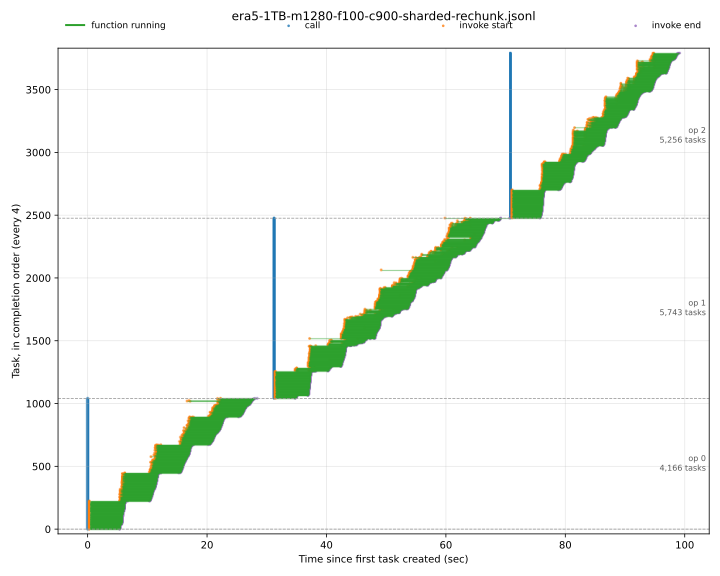
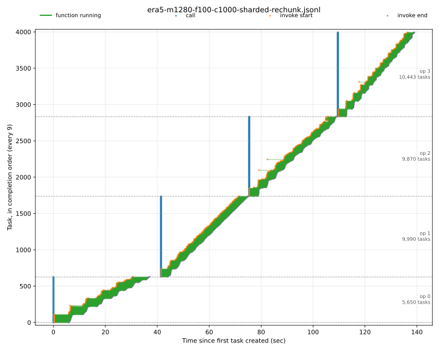

# Rechunk Lambda Benchmarks

How fast can we rechunk ERA5-scale Zarr data using the [map-lambda](https://github.com/tomwhite/map-lambda) framework?

**A four stage rechunk of the original ERA5 dataset (1 variable) 1.4TB takes ~140s and costs ~$2.45**

This is **3.7 times** faster than [an equivalent run using Cubed](https://github.com/cubed-dev/cubed/issues/650#issuecomment-2729027467) from last year.

## How it works

This project implements a rechunk copy using [Rust zarrs](https://zarrs.dev/) for performance, running on AWS Lambdas, with the rechunk logic coordinated by a Python frontend.

This project is set up for running benchmarks. It has a CLI for planning and running a rechunk, for creating and validating test data (specifically: incompressible, deterministically hashed integer values that are independent of chunking), and for getting stats and costs for the rechunk operations.

## Running locally

First run `cargo lambda watch` from the `rust/` directory. Then try these commands (note that they use `--local` to use the local lambdas, not AWS):

```shell
# Create an array of hashed integers
uv run rechunk-lambda-benchmarks hashed-integers /tmp/ints --shape 1000,1000 --chunks 100,100 --local

# Plan a rechunk
uv run rechunk-lambda-benchmarks plan /tmp/ints --target-chunks 50,50

# Run a rechunk
uv run rechunk-lambda-benchmarks rechunk /tmp/ints /tmp/ints-rechunked --target-chunks 50,50 --local

# Check the rechunked array
uv run rechunk-lambda-benchmarks validate-hashed-integers /tmp/ints-rechunked --local
```

## Running on AWS

### Deployment

```shell
./aws/setup-roles.sh   # once - wait a few seconds for IAM to apply
./aws/deploy.sh
./aws/teardown.sh      # when you're finished
```

### Sanity check

```shell
uv run rechunk-lambda-benchmarks hashed-integers s3://rechunk-lambda-benchmarks/ints --shape 1000,1000 --chunks 100,100
uv run rechunk-lambda-benchmarks rechunk s3://rechunk-lambda-benchmarks/ints s3://rechunk-lambda-benchmarks/ints-rechunked --target-chunks 50,50
uv run rechunk-lambda-benchmarks validate-hashed-integers s3://rechunk-lambda-benchmarks/ints-rechunked
```

### Benchmarks

Start with a cutdown dataset to check everything is working properly:

```shell
# dry run
DRY=1 MEM=1280 FRAC=100 SHARD=1 CONC=500 benchmarks/era5.sh era5-10GB
# real run
MEM=1280 FRAC=100 SHARD=1 CONC=500 benchmarks/era5.sh era5-10GB
```

Run a medium-sized dataset (100GB):

```shell
# dry run
DRY=1 MEM=1280 FRAC=100 SHARD=1 CONC=500 benchmarks/era5.sh era5-100GB
# real run
MEM=1280 FRAC=100 SHARD=1 CONC=500 benchmarks/era5.sh era5-100GB
```

Run a large-sized dataset (1TB):

```shell
# dry run
DRY=1 MEM=1280 FRAC=100 SHARD=1 CONC=900 benchmarks/era5.sh era5-1TB
# real run
MEM=1280 FRAC=100 SHARD=1 CONC=900 benchmarks/era5.sh era5-1TB
```

In one run, the rechunk part took 100.31s and cost approximately $1.68.



Run the original size dataset (1.4TB):

```shell
# dry run
DRY=1 MEM=1280 FRAC=100 SHARD=1 CONC=1000 benchmarks/era5.sh era5
# real run
MEM=1280 FRAC=100 SHARD=1 CONC=1000 benchmarks/era5.sh era5
```

In one run, the rechunk part took 142.68s and cost approximately $2.45. This is 3.7 times faster than [an equivalent run using Cubed](https://github.com/cubed-dev/cubed/issues/650#issuecomment-2729027467).



The benchmarks do *not* automatically delete the test data, but they do show a command you can run.
Don't forget to run it though as the storage costs mount up quickly for multi-TB datasets!

## AI usage

Code and tests were written with AI assistance from Claude.

